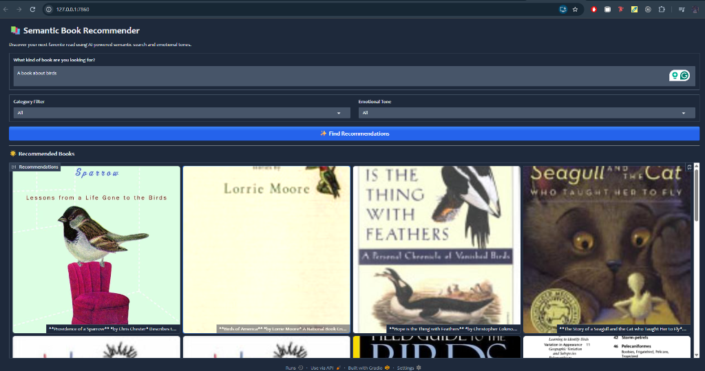
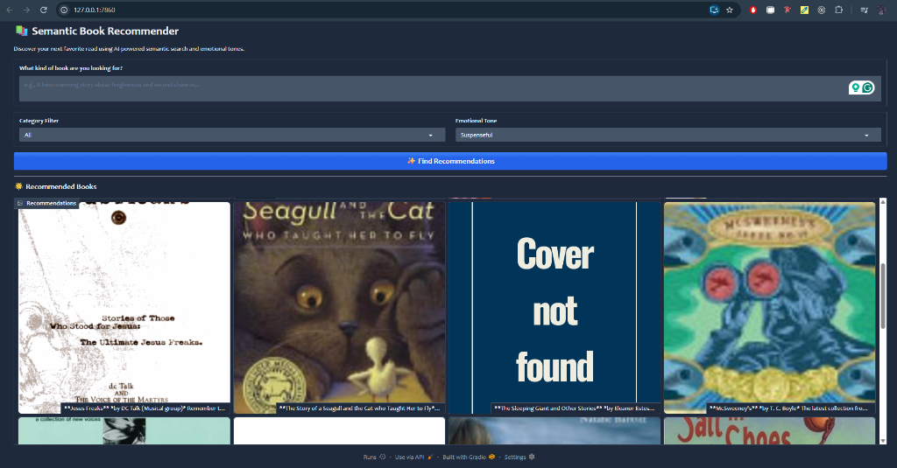

# 📚 Semantic Book Recommender

An AI-powered book recommendation system that uses **semantic search** and **emotional tone analysis** to help you discover your next favorite read. Built with LangChain, ChromaDB, HuggingFace Transformers, and Gradio.

---

## 🖥️ Demo

| Semantic Search by Topic | Filter by Emotional Tone |
|:---:|:---:|
|  |  |

> **Left:** Searching *"A book about birds"* returns semantically relevant recommendations with book covers and author captions.  
> **Right:** Filtering results by the *Suspenseful* emotional tone re-ranks books using fear-emotion scores from the sentiment model.

---

## ✨ Features

- 🔍 **Semantic Search** — Natural language queries understood via vector embeddings (`google/embeddinggemma-300m`)
- 😄 **Emotional Tone Filtering** — Re-rank results by mood: Happy, Surprising, Angry, Suspenseful, or Sad
- 📂 **Category Filtering** — Narrow results by genre (Fiction, Nonfiction, Children's Fiction, etc.)
- 🖼️ **Book Cover Gallery** — Shows large book cover thumbnails with titles, authors, and truncated descriptions
- ⚡ **GPU-Accelerated** — Inference runs on CUDA for fast embedding and classification

---

## 🗂️ Project Structure

```
book-recommender/
│
├── data-exploration.ipynb        # Step 1: Data loading, cleaning & EDA
├── text-classification.ipynb     # Step 2: Zero-shot genre classification
├── sentiment-analysis.ipynb      # Step 3: Emotion scoring per book description
├── vector-search.ipynb           # Step 4: Semantic vector search with ChromaDB
│
├── gradio-dashboard.py           # Step 5: Interactive Gradio web app
│
├── books_cleaned.csv             # Cleaned dataset (7k books)
├── books_with_categories.csv     # Dataset enriched with genre labels
├── books_with_emotions.csv       # Final dataset with emotion scores
├── tagged_description.txt        # ISBN-tagged descriptions for embedding
│
├── cover-not-found.jpg           # Fallback image for missing book covers
├── assets/                       # Demo screenshots
├── requirements.txt              # Python dependencies
└── .env                          # HuggingFace API token (not committed)
```

---

## 🔬 Pipeline Overview

The project is built across **5 sequential notebooks + a dashboard**, each building on the previous step:

### 1. `data-exploration.ipynb` — Data Loading & Cleaning
- Downloads the [7k Books with Metadata](https://www.kaggle.com/datasets/dylanjcastillo/7k-books-with-metadata) dataset via `kagglehub`
- Explores missing values with heatmaps (Seaborn)
- Analyzes correlations between `num_pages`, `age_of_book`, `average_rating`, and `missing_description`
- Filters out books with missing descriptions, fewer than 25 words in description, or missing key metadata
- Creates `tagged_description` column (ISBN + description) for use in vector search
- Outputs: `books_cleaned.csv`

### 2. `text-classification.ipynb` — Genre Classification
- Maps fine-grained categories into simplified labels: `Fiction`, `Nonfiction`, `Children's Fiction`
- Uses **zero-shot classification** (`facebook/bart-large-mnli`) to classify books with no existing category
- Validates model accuracy against labeled data (~300 books each for Fiction and Nonfiction)
- Outputs: `books_with_categories.csv`

### 3. `sentiment-analysis.ipynb` — Emotion Scoring
- Uses `j-hartmann/emotion-english-distilroberta-base` to classify emotions sentence-by-sentence
- Emotions tracked: `anger`, `disgust`, `fear`, `joy`, `sadness`, `surprise`, `neutral`
- Takes the **max emotion score per sentence** across all sentences in a description
- Merges emotion scores back into the books DataFrame
- Outputs: `books_with_emotions.csv`

### 4. `vector-search.ipynb` — Semantic Vector Search
- Embeds all `tagged_description` values using `google/embeddinggemma-300m` (via LangChain + HuggingFace)
- Stores embeddings in a **ChromaDB** vector store
- Implements `retrieve_semantic_recommendations()` for top-k similarity search
- Outputs: in-memory ChromaDB used by the dashboard

### 5. `gradio-dashboard.py` — Interactive Web App
- Loads `books_with_emotions.csv` and initializes the ChromaDB vector store
- Accepts a free-text query, optional category filter, and optional emotional tone filter
- Retrieves top-50 semantic matches → filters by category → selects top-16 → re-ranks by emotion
- Renders results as a **4-column book cover gallery** with captions (title, author, description snippet)
- Runs locally via Gradio with `dashboard.launch()`

---

## 🚀 Getting Started

### Prerequisites

- Python 3.10+
- CUDA-compatible GPU (recommended for fast inference)
- A [HuggingFace](https://huggingface.co/) account and API token

### Installation

```bash
# Clone the repository
git clone https://github.com/your-username/book-recommender.git
cd book-recommender

# Create and activate a virtual environment
python -m venv .venv
.venv\Scripts\activate      # Windows
# source .venv/bin/activate   # macOS/Linux

# Install dependencies
pip install -r requirements.txt
```

### Configuration

Create a `.env` file in the project root:

```env
HUGGINGFACEHUB_API_TOKEN=your_token_here
```

### Running the Notebooks

Run the notebooks **in order** to generate the required CSV files:

```
1. data-exploration.ipynb       → books_cleaned.csv
2. text-classification.ipynb    → books_with_categories.csv
3. sentiment-analysis.ipynb     → books_with_emotions.csv
4. vector-search.ipynb          → (validates the vector search pipeline)
```

### Launching the Dashboard

```bash
python gradio-dashboard.py
```

Then open your browser at **http://127.0.0.1:7860**

---

## 🛠️ Tech Stack

| Component | Technology |
|---|---|
| Data Processing | `pandas`, `numpy` |
| Data Visualization | `seaborn`, `matplotlib` |
| Genre Classification | `facebook/bart-large-mnli` (zero-shot) |
| Emotion Analysis | `j-hartmann/emotion-english-distilroberta-base` |
| Text Embeddings | `google/embeddinggemma-300m` |
| Vector Store | `ChromaDB` via `langchain-chroma` |
| LLM Orchestration | `LangChain` |
| Web UI | `Gradio` (Glass theme) |
| ML Backend | `PyTorch` + `Transformers` + `sentence-transformers` |

---

## 📦 Dependencies

```
gradio
pandas
numpy
python-dotenv
langchain-chroma
langchain-huggingface
chromadb
torch
transformers
sentence-transformers
```

Install with:
```bash
pip install -r requirements.txt
```

---

## 📊 Dataset

**[7k Books with Metadata](https://www.kaggle.com/datasets/dylanjcastillo/7k-books-with-metadata)** by Dylan Castillo on Kaggle.

After cleaning and filtering (requiring descriptions ≥ 25 words, no missing key fields), the final dataset contains approximately **6,800+ books** with:
- Title, subtitle, authors
- ISBN-13, published year, number of pages
- Average rating, categories
- Book cover thumbnail URLs
- AI-generated genre labels and emotion scoresS
